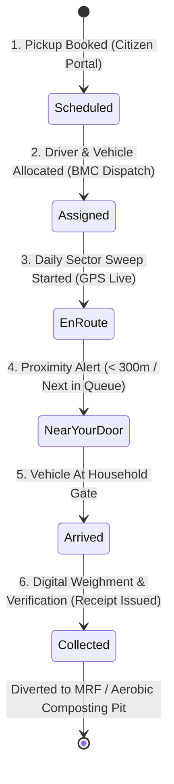
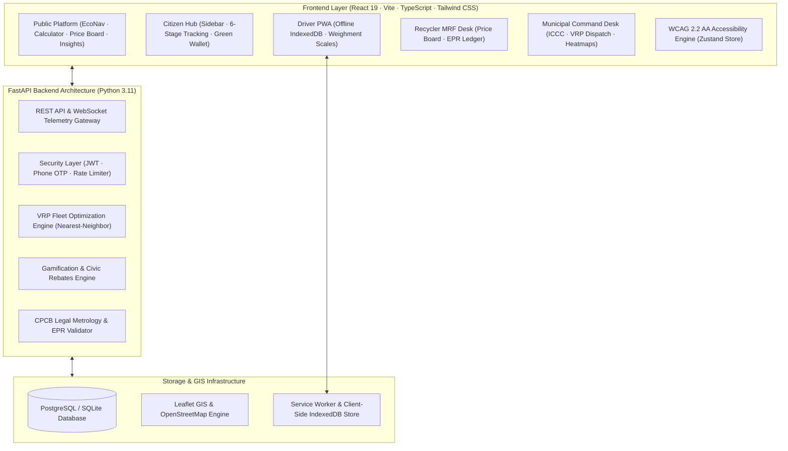

<div align="center">

# ♻️ EcoSync
### Smart Waste & Circular Economy Operating Network
**Official Civic Platform for Bhopal Municipal Corporation (BMC) · Swachh Bharat Mission Urban 2.0**

[](https://fastapi.tiangolo.com)
[](https://react.dev)
[](https://www.typescriptlang.org)
[](https://www.w3.org/WAI/standards-guidelines/wcag/)
[](backend/tests/)
[](LICENSE)

<p align="center">
  <a href="#-executive-summary">Executive Summary</a> •
  <a href="#-the-best-of-ecosync-core-innovations">Core Innovations</a> •
  <a href="#-multi-role-portals">Portals</a> •
  <a href="#-system-architecture">Architecture</a> •
  <a href="#-digital-accessibility-wcag-22-level-aa">Accessibility</a> •
  <a href="#-quickstart-guide">Quickstart</a> •
  <a href="#-demo-credentials">Demo Accounts</a> •
  <a href="#-testing--verification">Testing</a>
</p>

---

</div>

## 📌 Executive Summary

**EcoSync** is an enterprise-grade smart-city operating system engineered for the **Bhopal Municipal Corporation (BMC)** across all **85 wards (Zones 1–14)**. It bridges **14,000+ households**, municipal collection drivers, certified Material Recovery Facilities (MRFs), and city administrators into a single unified operating network.

Designed to eliminate unverified landfill dumping at the Adampur Chhawani site, EcoSync replaces legacy paper manifests with:
* **Sub-second GPS vehicle tracking** and automated proximity alerts.
* **Point-of-collection digital weighment** calibrated to Central Pollution Control Board (CPCB) standards.
* **Closed-loop scrap marketplace trading** that mints transparent Extended Producer Responsibility (EPR) credits.
* **Gamified civic incentives** that reward source-segregation with property tax rebates.

---

## 🌟 The Best of EcoSync (Core Innovations)



### 1. 🚛 Live GPS Telemetry & Proximity Notification Engine
* Sub-second vehicle tracking visualized via **Leaflet GIS** and OpenStreetMap.
* Automated **proximity alerts** trigger when the municipal vehicle is within **300 meters** of the resident's doorstep, prompting households to bring out segregated bins.
* Accessible text alternative (`aria-live="polite"`) providing spoken telemetry (speed, route, driver name, ETA) for visually impaired and low-bandwidth users.

### 2. 🔄 6-Stage Collection Lifecycle & Verification
* Every pickup progresses through an auditable, six-stage state machine:
  $$\text{Scheduled} \longrightarrow \text{Assigned} \longrightarrow \text{En Route} \longrightarrow \text{Near Your Door} \longrightarrow \text{Arrived} \longrightarrow \text{Collected}$$
* Doorstep collection drivers verify segregation and log net kilogram weights using calibrated digital scales, generating immediate SMS receipts.

### 3. ⚖️ Standardized 4-Stream Waste Sorting
* **Green Stream (Wet Organic):** Food scraps, fruit/vegetable peels, garden cuttings; routed to decentralized aerobic composting.
* **Blue Stream (Dry Recyclables):** PET bottles, HDPE plastics, cardboard, metal cans, glass; routed to certified recovery hubs.
* **Red Stream (Domestic Hazardous):** Expired pharmaceuticals, paint solvents, chemical containers; routed to industrial containment.
* **Purple Stream (E-Waste):** Circuit boards, batteries, chargers, mobile electronics; high-yield recovery with auditable EPR minting.

### 4. 🧮 Interactive Circular Rewards Calculator
* Citizens simulate waste streams, weights ($1 - 50\text{ kg}$), and segregation quality on the public portal.
* Automatically computes:
  * **Earned EcoPoints:** Base $50\text{ pts}$ + weight bonus $\times 1.25$ streak multiplier.
  * **Carbon Offset ($\text{kg CO}_2\text{e}$):** Evaluated via EPA WARM v15 landfill avoidance factors ($1.1\text{ to }5.2\text{ kg CO}_2\text{e/kg}$).
  * **Direct Cash Value:** Live Bhopal scrap benchmark payout estimates.

### 5. 📈 Live Scrap Price Board & EPR Credit Ledger
* Real-time benchmark price board for secondary commodities across Bhopal (PET, HDPE, Cardboard, Aluminium, Copper, E-Waste).
* Seven-day trend indicators with verified local MRF buyer tags.
* Brand producers and packaging manufacturers generate verifiable CPCB-compliant EPR credit certificates to satisfy statutory ESG obligations.

### 6. 📡 Zero-Drop Offline PWA for Dense Alleyways
* Driver application runs as a **Progressive Web App (PWA)** backed by an **IndexedDB** queue.
* Drivers navigating Bhopal's narrow, signal-dead alleyways log collections without interruption; all actions queue client-side and synchronize automatically upon reconnect with SHA-256 server idempotency.

---

## 👥 Multi-Role Portals

```
┌────────────────────────────────────────────────────────────────────────┐
│                        EcoSync Operating Grid                          │
└───────┬───────────────────┬───────────────────┬──────────────────┬─────┘
        │                   │                   │                  │
        ▼                   ▼                   ▼                  ▼
┌──────────────┐    ┌──────────────┐    ┌──────────────┐   ┌──────────────┐
│  Citizen     │    │  Driver      │    │  Recycler    │   │  Municipal   │
│  Hub         │    │  PWA         │    │  MRF Desk    │   │  Command     │
└──────────────┘    └──────────────┘    └──────────────┘   └──────────────┘
```

| Portal | Core Capabilities | URL Route |
| :--- | :--- | :--- |
| **🏠 Citizen Hub** | Modern sidebar navigation, 6-stage collection progress tracker, on-demand doorstep booking, missed pickup emergency filing, EcoPoints green wallet, housing society (RWA) leaderboards, and geo-tagged grievance resolution. | [`/dashboard/user`](http://localhost:5173/dashboard/user) |
| **🚛 Driver PWA** | Turn-by-turn stop sequencing, digital scale weighment logging across 4 waste streams, offline-first IndexedDB background queue, and daily route performance analytics. | [`/dashboard/driver`](http://localhost:5173/dashboard/driver) |
| **♻️ Recycler MRF Desk** | Facility rate-card publisher, public scrap price board updater, citizen lot intake verification, and digital CPCB Extended Producer Responsibility (EPR) certificate minting. | [`/dashboard/recycler`](http://localhost:5173/dashboard/recycler) |
| **🏛️ Municipal Command Desk** | Comprehensive city command dashboard covering all 85 wards, Nearest-Neighbor Vehicle Routing Problem (VRP) fleet dispatch, live GIS telematics, spatial complaint heatmaps, and aerobic compost batch oversight. | [`/dashboard/admin`](http://localhost:5173/dashboard/admin) |

---

## 🏗️ System Architecture



---

## ♿ Digital Accessibility (WCAG 2.2 Level AA)

EcoSync treats accessibility as a foundational requirement:

* **High Contrast Mode:** Dedicated $>7:1$ contrast ratio with sharp boundaries and zero reliance on color alone.
* **Scalable Typography:** Four proportional tiers (`sm`, `base`, `lg`, `xl`) utilizing scalable `rem` units without layout clipping.
* **Screen Reader Optimization:** Semantic HTML5 elements (`<header>`, `<nav>`, `<main>`, `<section>`, `<ol>`), ARIA live regions (`aria-live="polite"`), and non-visual text alternatives for GIS maps and telemetry.
* **Keyboard Navigation:** Universal focus management (`:focus-visible`), logical tab indexing, skip-to-content links (`.skip-link`), and escape key dismissals.
* **Motor Accessibility:** Touch targets calibrated to $\ge 44 \times 44\text{ CSS pixels}$ with generous interactive spacing.

---

## 🎨 Design System & Visual Tokens

The platform implements an 8px spacing system inspired by modern enterprise SaaS:

| Design Token | Hex Code | Purpose |
| :--- | :--- | :--- |
| **Primary Green** | `#009B70` | Primary branding, buttons, active states, progress indicators |
| **Deep Green** | `#006B4F` | Hover accents, section headers, badges |
| **Dark Navy** | `#101828` | High-contrast text, primary headings, dark surfaces |
| **Secondary Text** | `#475467` | Supporting body copy, metadata labels |
| **Background** | `#F7F9FC` | Clean civic background tone |
| **Card Background** | `#FFFFFF` | Elevated surfaces, modals, popovers |
| **Border Neutral** | `#E4E7EC` | Standard container outlines |
| **Light Green** | `#EAFBF4` | Soft pill badges, selection highlights |

---

## 🚀 Quickstart Guide

### Prerequisites
* **Node.js** (v18+ recommended) & **npm**
* **Python** (v3.11+)

---

### 1. Backend Setup

```bash
# Navigate to the backend directory
cd backend

# Create and activate Python virtual environment
# Windows (PowerShell):
python -m venv venv
.\venv\Scripts\activate

# Linux / macOS:
# python3 -m venv venv
# source venv/bin/activate

# Install dependencies
pip install -r requirements.txt

# Start the API server
uvicorn app.main:app --reload --port 8000
```

> **API Server:** [`http://localhost:8000`](http://localhost:8000)  
> **Interactive Swagger Documentation:** [`http://localhost:8000/docs`](http://localhost:8000/docs)

---

### 2. Frontend Setup

```bash
# In a new terminal, navigate to the frontend directory
cd frontend

# Install dependencies
npm install

# Start Vite development server
npm run dev
```

> **Web Application:** [`http://localhost:5173`](http://localhost:5173)

---

## 🔑 Demo Credentials

To populate your local environment with representative Bhopal municipal wards, collection vehicles, scrap rate cards, and users, run the database seeder:

```bash
cd backend
python seed_dev.py
```

Log in using any of the seeded credentials on the [Login Screen](http://localhost:5173/login):

| Persona | Email | Phone Number | Password | Target Dashboard |
| :--- | :--- | :--- | :--- | :--- |
| **Citizen** | `aarav@citizen.org` | `9876543210` | `password123` | [`/dashboard/user`](http://localhost:5173/dashboard/user) |
| **Driver** | `rajesh.driver@ecosync.org` | `9876543211` | `password123` | [`/dashboard/driver`](http://localhost:5173/dashboard/driver) |
| **Recycler** | `vikram.malhotra@recycler.org` | `9876543212` | `password123` | [`/dashboard/recycler`](http://localhost:5173/dashboard/recycler) |
| **Municipal Admin** | `admin@ecosync.org` | `9876543213` | `password123` | [`/dashboard/admin`](http://localhost:5173/dashboard/admin) |

> **Development OTP Bypass:** When testing phone-based authentication in development mode, use code **`1234`** for instant verification.

---

## 🧪 Testing & Verification

EcoSync includes automated verification across both backend and frontend environments:

### Backend Test Suite (108 Tests)
```bash
cd backend
pytest tests/ -v
# Result: 108 passed in 60s (100% pass rate)
```

### Frontend Production Build & Typecheck
```bash
cd frontend
npm run build
# Result: 0 errors, built in ~11s
```

### Static Analysis & Linter
```bash
cd frontend
npm run lint
# Result: 0 errors
```

---

## 📍 Municipal Directory & Helplines

* **Bhopal Municipal Corporation 24/7 Waste Control Room:** `1800-233-0014`
* **City Civic Helpline:** `155304`
* **Control Room Email:** `controlroom@bhopalcorp.gov.in`
* **Central Processing Site:** Adampur Chhawani Integrated Solid Waste Processing Plant, Bhopal, Madhya Pradesh
* **Civic Coverage:** All 85 BMC Wards across Zones 1–14

---

## 📄 License

This project is licensed under the MIT License — see the [LICENSE](LICENSE) file for details.
